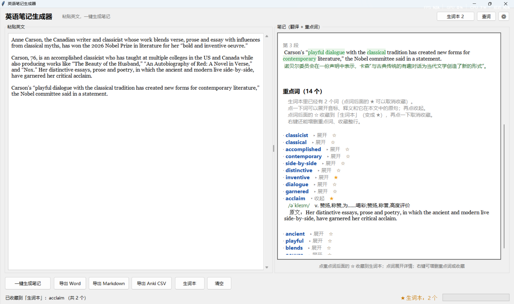

# 英语笔记生成器

一个 tkinter 桌面小工具：**粘贴英文，点一个按钮，得到一份笔记**。

笔记只有三样东西：**原文 → 中文翻译 → 重点词（带音标和中文释义）**。



上图这一屏里能看到全部主要功能：

- 左边是原文面板，右边是笔记（**逐段中英对照**，重点词在英文里用绿色标出）
- 重点词每条后面有一颗星：**☆ = 未收藏，★ = 已收藏**（点一下即可收藏到生词本）
- `acclaim` 这一条是**展开状态**：显示音标 `/əˈkleɪm/`、词性释义，以及**它在本文中的原句**
- 顶栏和底部都有「生词本」按钮，右下角常驻显示 **★ 生词本：2 个**
- 底部状态栏会回显刚才的动作：「已收藏到「生词本」：acclaim （共 2 个）」
- 可以随意**增删**重点词

## 一、怎么运行

```
cd 到本项目文件夹
python english_note_generator.py
```

**不需要安装任何库，也不需要填任何密钥。** 打开就能用（只要装了 Python 3，tkinter 是自带的）。

> 如果 `python` 命令没反应、或被应用商店拦截，改用 `py english_note_generator.py`。

**整个项目就是这一个文件夹**，复制走就能在别的电脑上用（前提是装了 Python 3）。
词库、缓存、导出全都跟着这个文件夹走，不会写到别的地方。

用法：粘贴英文 → 点「一键生成笔记」→ 看右边 →（可选）调整重点词 → 导出。
底部按钮：**一键生成笔记 / 导出 Word / 导出 Markdown / 导出 Anki CSV / 生词本 / 清空**。

**点「一键生成笔记」会自动存一份 Word**；其它格式点对应按钮导出，都存进本文件夹下的「导出的笔记」。
**收藏的重点词**（点重点词后面的 ☆）单独存在本文件夹下的「生词本」里，见第二节。

### 翻译失败了怎么办：单段重试

某一小段翻译失败时，那一格**不会用英文原文占位**，而是显示一个红色的可点击链接：

```
第 2 段
[翻译失败，点击重试 · 第 2 段]        ← 点它只重翻这一段
```

点一下只重试这一段（不会重新生成整篇、不影响其它段落）。如果重试仍失败，
状态栏会写明原因（例如"免费翻译额度已用完（HTTP 429）"）。

**长段落是分块翻译的**，所以还有两种情况要知道：

- **部分成功**：只有其中一块没翻出来时，程序**不会把整段作废**，
  已经翻好的部分照常显示给你看，状态栏会写"笔记已生成，但翻译不完整：第 2 块没翻出来（原因）……"。
  这时点那一段的重试链接，就能把缺的部分补上。
- **标点不会跟句子分家**：句末的引号、右括号一定跟着它所属的那一句走
  （以前会把末尾一个 `"` 单独切成一块发出去，接口识别不了，导致整段报失败 —— 已修）。

## 二、重点词卡片：点一下展开

重点词默认**只显示单词**，保持列表清爽（后面那颗 ☆ 是"收藏到生词本"，见第四节）：

```
· satellite　▸ 展开　☆
· authorities　▸ 展开　★
```

**点一下某个词**（点在词上，别点星星），就在原地展开它的详情（音标、词性释义、**它在本文中的原句**）；再点收起：

```
· satellite　▾ 收起　☆
    /ˈsætəlaɪt/　n. 卫星;人造卫星;卫星国,附属国…
    原文：Urban planners increasingly rely on satellite imagery to monitor informal settlements.
```

「本文原句」是直接从文章里取的，不需要额外联网。

## 三、重点词是可以自己改的

左边也是**原文面板** —— 你粘进去的英文一直留在那里，生成笔记后还能在上面操作。
自动挑出来的重点词不一定符合你的水平，所以随时可以增删，**全部用右键**：

| 想做什么      | 怎么做                                     |
| --------- | --------------------------------------- |
| **加入一个词** | 在左边原文的词上**点右键** → 选「加入重点词：xxx」          |
| **删掉一个词** | 在右边重点词上**点右键** → 选「从重点词中删除：xxx」         |
| **收藏一个词** | 在右边重点词后面的 **☆ 上点一下**（变成 ★）；或右键选「收藏到生词本」 |
| **取消收藏**  | 在 **★ 上再点一下**；或右键选「取消收藏（从生词本删除）」        |

**右键时的绿色反馈**：你右键某个词的瞬间，原文里那个词会立刻**变绿**，
底部提示条也会说明"选择加入即保留绿色，选取消则恢复原样"：

- 选择「加入重点词」→ 词进入重点词表，绿色**保留**
- 选择「取消（恢复原样）」→ 绿色**立刻消失**，回到原来的样子
- 直接关掉菜单（点别处）→ 同样恢复原样

要点：

- 只会拒绝**虚词**（`in`、`the`、`this` 这类）和 1-2 个字母的词，并在菜单里说明原因；其它都尊重你的选择
- 手工加入的词会**自动联网补上音标和中文释义**
- 删除对**变形词**也有效：原文里是 `analysed`，右键删除它的原形 `analyse` 一样生效
- 删除是**永久生效**的（即使这个词在词库里，也不会被重新识别加回来）
- 每次点「一键生成笔记」会**重置**这些手工改动（重新开始一轮）
- 重点词不影响翻译，改完立刻重画，**不需要重新联网翻译**

## 四、收藏重点词：生词本

重点词表是"这一篇文章"的，看完就过去了。想长期攒起来反复背的，就**收藏**它。

**怎么收藏**：重点词后面那颗空心星 **☆ 点一下**，它变成实心 **★**，这个词就进了生词本：

```
重点词（14 个）
　点一下词可以展开音标、释义和它在本文中的原句；再点收起。
　点词后面的 ☆ 收藏到「生词本」（变成 ★），再点一下取消收藏。

· ubiquitous　▸ 展开　★        ← 已收藏
· methodology　▸ 展开　☆        ← 点这里收藏，再点一次取消
```

也可以**右键**收藏：在右边重点词上右键 →「收藏到生词本」；在左边原文的词上右键也有这一项。
右键时菜单会告诉你当前状态（已经收藏过的词显示的是「取消收藏」）。

**收藏了什么内容**：单词 + 音标 + 词性 + 中文释义 + 它在本文里的原句 + 考试标签（六级/雅思/考研…），
以及收藏时间。这些都是自动带上的，不用你填。

**存在哪里**：本文件夹下新建的「生词本」文件夹里（不是「导出的笔记」）：

```
英语笔记生成器\
├── 导出的笔记\                        ← 每次生成的笔记 Word / Markdown / CSV
└── 生词本\                            ← 只有收藏的重点词（第一次收藏时自动创建）
    ├── 生词本.json                    ← 收藏的"底账"（程序读它、写它）
    ├── 生词本.md                      ← 同样内容的可读版，随时自动重写
    ├── Vocabulary_20261011_131058.docx      ← 点「导出 Word」才有
    ├── Vocabulary_20261011_131058.md        ← 点「导出 Markdown」才有
    └── Vocabulary_20261011_131058_Anki.csv  ← 点「导出 Anki CSV」才有
```

要点：

- **收藏是长期的**。点「清空」、点「一键生成笔记」都**不会**动生词本；只有你自己点 ★ 或去生词本窗口删才会少。
- **收藏过的词，下次再遇到一定还是重点词**（即使这一轮程序没自动挑出来），所以"收藏了就不认识"不会发生。
- **重复收藏同一个词是安全的**：不会出现两条，只会把缺的释义/原句补上，并把收藏时间更新成最新。
- **收藏的词会立即存盘**，不用手动保存，也不怕程序崩。

**怎么看和整理**：点顶栏或底部的「生词本」按钮（状态栏右下角那颗星星也能点），会打开生词本窗口：

| 想做什么       | 怎么做                                     |
| ---------- | --------------------------------------- |
| **看详情**    | 在列表里**双击**某一行，弹出音标、释义、原句                |
| **删掉几个词**  | 选中一行或多行（按住 Ctrl 多选）→ 点「删除选中」或按 `Delete` |
| **导出复习材料** | 「导出 Word」/「导出 Markdown」/「导出 Anki CSV」   |
| **看文件在哪**  | 点「打开文件夹」，直接打开「生词本」文件夹                   |

三种导出都带**时间戳**（如 `Vocabulary_20261011_131058.docx`），所以反复导出不会互相覆盖。
Anki CSV 是「正面 / 背面 / 标签」三列，直接在 Anki 里导入即可。

**每次点「一键生成笔记」，都会自动在本文件夹下的「导出的笔记」里存一份 Word**（不用选路径、不用另存）：

```
英语笔记生成器\                        ← 整个项目就在这一个文件夹里
├── english_note_generator.py
├── notebook_engine.py / dictionary.py / translator_api.py
├── exam_vocab.txt                     ← 重点词库
├── README.md / screenshot.png
├── dict_cache.json / auto_tr_cache.json   ← 本地缓存（可随时删）
├── 导出的笔记\                        ← 自动创建
│   ├── English_Notes_20261011_110315.docx
│   ├── English_Notes_20261011_110400.md
│   └── English_Notes_20261011_110400.csv
│       └──────┬──────┘└──┬───┘
│         固定前缀    日期_时分秒
└── 生词本\                            ← 收藏的重点词（第一次收藏时自动创建）
    ├── 生词本.json                    ← 收藏的底账（真正存数据的文件）
    └── 生词本.md                      ← 可读版，随时自动重写
```

文件名带时间戳，所以**多次导出不会互相覆盖**，历史笔记都留着。状态栏会提示本次生成的文件名。
「导出的笔记」和「生词本」文件夹不存在时会自动创建（手动删掉也能自愈；
不过删掉「生词本」文件夹就等于把收藏丢了，要备份就复制整个文件夹）。

Word 文档用的是**你调整后的重点词**：翻译板块里英文原文的重点词标成绿色（绿字 + 浅绿底），
文档后半部分是重点词表。

## 五、笔记里有什么

笔记栏只有**两块**，没有单独的"原文"板块 —— 原文直接放在翻译里，
**一段英文下面紧接该段中文**，英文里的重点词用**绿色**标出：

```
翻译
  第 1 段
  In 2019, London and New York hosted the Global Climate Summit, where
  Dr. Smith presented a comprehensive framework. The methodology was
  rigorous ...                       ← comprehensive / methodology 绿色
  2019 年，伦敦和纽约主办了全球气候峰会，史密斯博士介绍了一个全面的框架……

  第 2 段
  <英文原文第 2 段>
  <该段中文翻译>

重点词（14 个）
  点一下词可以展开音标、释义和它在本文中的原句；再点收起。
  点词后面的 ☆ 收藏到「生词本」（变成 ★），再点一下取消收藏。

  · substantial　▸ 展开　☆
  · methodology　▸ 展开　★
  ...
```

重点词**不带序号**，用「·」列出，默认收起，方便随时查看、删改和收藏。

### 重点词是怎么挑的

**优先高级词汇，按"高级程度"从高到低排列**：

- 词根/词缀信号：`ubiquitous`、`exacerbate`、`mitigate`、`relinquish`、`prerogative` 这类学术词排最前
- 其次是学术长词：`methodology`、`hypothesis`、`comprehensive`、`rigorous`
- 普通商务词（`corporations`）排在后面

**会排除五类**：

1. 四级以下常见词，以及常见词的变形（`workers`、`cannot`、`policies`、`evidence`、`expectations`、`growth`）
2. **所有格**：`corporation's`、`workers'`、`London's` —— 重点词只收**名词本身**，
   所有格形式永远不会成为词条（`corporation's` → 只认 `corporation`）
3. **代词与限定词**：`its`、`their`、`these`、`those`、`whose`、`either`、`neither`、`none`、
   `themselves`、`ones`、`others` 等
4. **地名**：`London`、`New York`、`Oxford`、`California`、`Amazon`、`Europe`、`Asia`
5. **人名**：`Dr. Smith`、`Johnson`、`Mary`、`Robert`、`Professor Miller`

识别依据：原文里是否被大写（排除句首的语法大写）、前后是否挨着其他大写词、
地名后缀（`-land/-ton/-shire`）、高频人名与地名表。被排除的词**也不会被绿色标注**。

右键点到这些词时，菜单会说明原因并给出建议，
例如右键 `corporation's` 会提示：**「corporation's」是所有格，请选它的原形「corporation」**。

**词库外的词会**运行时联网查音标和释义**（详见下面的限制）。

## 六、已知限制（重要，先看这里）

这个工具刻意做成"零配置"，代价是翻译和查词走的是**公开免费接口**。请了解以下几点：

1. **翻译质量是机器翻译水平。** 用的是公开的免费翻译接口（MyMemory）。语法正确、大意准确，但不如 DeepL 通顺，**不要直接当正式译文用**。
2. **必须联网。** 翻译和查词都要网络。断网时会明确提示"连不上翻译服务"，程序不会崩。
3. **免费翻译有每日额度。** MyMemory 匿名请求只有约 5,000 字符/天，很容易用完并返回
   `HTTP 429 Too Many Requests`。本程序已附带联系标识，额度提升到约 **50,000 字符/天**。
   万一还是用完，**状态栏会明确写出原因**（例如"免费翻译额度已用完（HTTP 429）"），
   而不是只显示"没拿到译文"。届时可以：
   - 等第二天额度重置
   - 或在「⚙ 设置」里填一个**百度翻译密钥**（免费额度更高、更稳定）
   - 已经成功过的段落会**缓存在本地**（`auto_tr_cache.json` / `dict_cache.json`），下次不再联网
4. **词典和翻译用的是网页公开接口**，不是签约的开放平台 API。它们可能随时调整，届时需要更新代码里对应的解析。
5. **每轮最多联网查 30 个重点词**，防止请求过多被限流。文本很长时会只查最重要的那些。
6. **隐私提醒**：用自动翻译时，你粘贴的英文段落会**发送到 MyMemory（Translated）** 的服务器；
   联网查词时，被查的**单词会发送到有道词典**。除此之外程序不会把内容发到别处，也没有任何统计上报。
   **请不要粘贴含个人隐私或未公开材料的文本。**

## 七、设计思路与技术要点

> 这一节是给"看代码的人"看的：为什么这么做、踩过什么坑、怎么验证。

**1. 零配置：不装库、不要密钥。**
只用 Python 标准库 + tkinter，所以克隆下来就能跑。代价是翻译和查词只能走公开免费接口，
所以配套做了三件事：① 结果缓存到本地，重复内容不再联网；② 每轮限制联网查词数量（30 个）；
③ 失败时给出**具体原因**，而不是静默空白。

**2. 逻辑与界面分离。**
`notebook_engine.py`（分段分句、词形还原、重点词筛选）里没有一行界面代码，
所以它可以单独跑、单独测；界面只做"拿文本 → 调它 → 显示结果"。

**3. 词库 + 运行时查词双保险。**
内置 315 词的考试词库（离线、必然有音标释义），词库没有的词再联网查并写入缓存。
这样常见词快而准，生僻词也不会漏。

**4. 分块翻译 + 标点随句（本项目修过的一个真 bug）。**
免费接口一次吃不下长段落，所以按 460 字节切块。最初的切法把**句末标点算作下一块的开头**，
当边界正好落在 `…ground."` 上时，会切出一块只有一个 `"` 的内容：

```
块1 (460B): '... cover more ground.'   ← 句号结束
块2 (  1B): '"'                        ← 只有一个引号，接口识别不了
```

结果接口原样吐回 → 程序判定"没有有效译文" → **整段报失败，前面翻好的句子也一起丢掉**。
修法：右引号/右括号只在**紧跟句末标点**时才算这一句的尾巴，保证标点永远跟着句子走；
再加一条兜底，绝不让"只有标点"的碎片单独发出去。
并且把"扫 24 种边界长度"写进了自检，防止以后退化。

**5. 部分成功也算成功。**
一块失败不再连累整段：翻好的部分照样显示，状态栏说明哪一块没翻出来，点重试可补全。

**6. 生词本：收藏是长期资料，和"这一轮笔记"分开。**
收藏立刻落盘（JSON 是底账，Markdown 是自动生成的可读副本），并采用
"先写临时文件再整体替换"的写法，避免写一半失败把攒下的收藏弄坏。
读取时对每个字段做类型兜底 —— 手改过、被截断的文件都不会让程序崩。

## 八、文件说明

| 文件                          | 作用                                            |
| --------------------------- | --------------------------------------------- |
| `english_note_generator.py` | 主程序（界面 + 单栏笔记渲染 + 自动导出 Word + 生词本窗口）          |
| `notebook_engine.py`        | 核心逻辑：分段分句、词形还原、重点词筛选、大意总结                     |
| `vocab_book.py`             | 生词本：收藏的存取（JSON）、去重、Markdown / Anki CSV 渲染     |
| `dictionary.py`             | 运行时联网查词（音标 + 中文释义），带本地缓存                      |
| `translator_api.py`         | 自动翻译（免密钥）+ 可选的 AI 总结 + 翻译网站链接                 |
| `diagnose_translation.py`   | 翻译失败时用来定位原因的小工具（见第一节末尾）                       |
| `exam_vocab.txt`            | 内置重点词库（315 词），**想加词就改这里**                     |
| `来源与许可.md`                  | 第三方代码库 / 在线服务 / 素材的来源、许可与署名说明（见第九节）           |
| `LICENSE`                   | 本项目自身的开源许可（MIT）                               |
| `导出的笔记/`                    | 导出的 Word / Markdown / Anki CSV 都在这个文件夹里（可随时删） |
| `生词本/`                      | 收藏的重点词（`生词本.json` 是底账，`生词本.md` 是自动生成的可读版）     |
| `dict_cache.json`           | 查词缓存（自动生成，可随时删）                               |
| `auto_tr_cache.json`        | 译文缓存（自动生成，可随时删）                               |
| `config.json`               | 可选设置（只有填了 AI 密钥才会生成）                          |
| `tests/`                    | 测试脚本，平时不用管                                    |

每个模块末尾都有自检，可以单独跑：

```
python notebook_engine.py            # 分段分句、词形还原、重点词筛选、大意总结
python vocab_book.py                 # 生词本：收藏、去重、落盘、两种导出
python dictionary.py --live          # 联网查词（--live 才真的联网）
python translator_api.py --live      # 自动翻译（--live 才真的联网）
```

还有一个**不联网的界面测试**，专门检查收藏（☆/★）这一套。它会自己开一个窗口、
模拟点击星星，然后把收藏写进临时文件夹（不会碰你真正的生词本）：

```
python tests\test_bookmark_gui.py
```

## 九、第三方来源与许可

本项目自身以 **MIT** 许可开源（见 [LICENSE](LICENSE)）。用到的第三方东西，完整清单、许可与署名说明都在
**[来源与许可.md](来源与许可.md)**（含最后的核对日期）。摘要：

| 用了什么                                                                              | 用途                     | 许可 / 出处                                                |
| --------------------------------------------------------------------------------- | ---------------------- | ------------------------------------------------------ |
| **Python 标准库** + **tkinter**                                                      | 全部核心功能与界面              | PSF License（随 Python 分发）                               |
| [python-docx](https://github.com/python-openxml/python-docx)                      | 导出 Word（**可选**依赖，延迟导入） | **MIT**                                                |
| [MyMemory](https://mymemory.translated.net/doc/spec.php)（Translated 提供）           | 默认的免费机器翻译              | 公开接口，免密钥；**须署名为 MyMemory/Translated**（本文件与 README 已注明） |
| [有道词典](https://ai.youdao.com/DOCSIRMA/html/dictionary/api/ydcd/index.html) 公开网页接口 | 联网查单词音标与释义             | ⚠️ 非官方签约 API，仅只读查询 + 本地缓存 + 每轮限流                       |
| 百度翻译 / DeepL / 大模型接口（DeepSeek、OpenAI、Moonshot、阿里云百炼）                              | 可选：更稳定的翻译 / AI 归纳大意    | 均为**官方接口**，**密钥由使用者自行申请**，本项目不内置任何密钥                   |
| 有道 / 百度 / DeepL / Google / Bing 翻译网页链接                                            | 一键跳转浏览器查看译文            | 仅拼接公开网址，不抓取内容                                          |

**项目内的数据与素材**：重点词库 `exam_vocab.txt`（315 词）为**自行整理**；
代码与截图中的英文例句为**自行编写**的教学用句，未摘自新闻、教材或他人作品。
以上各项及其商标归属，详见 [来源与许可.md](来源与许可.md)。

## 十、可选：让大意更凝练（AI 总结）

笔记里那行「大意」默认由程序按每段主题句自动归纳，**不需要任何配置**。

若想让它由大模型写成更凝练的中文，点右上角「⚙」填一个 OpenAI 兼容的密钥即可。

| 服务商      | 接口地址                                           | 模型              |
| -------- | ---------------------------------------------- | --------------- |
| DeepSeek | `https://api.deepseek.com/v1/chat/completions` | `deepseek-chat` |
| OpenAI   | `https://api.openai.com/v1/chat/completions`   | `gpt-4o-mini`   |

不填完全不影响使用。


